<div align="center">

<picture>
  <source media="(prefers-color-scheme: dark)" srcset="docs/assets/banner-dark.svg">
  
</picture>

<br>

[](https://github.com/CBFerrum/ferrum-app-edge/actions/workflows/ci.yml)
[](CHANGELOG.md)
[](LICENSE)
[](https://github.com/CBFerrum/Ferrum)


### Describe a device in a few lines, draw the logic, and let a gateway keep working when the link goes down.

IoT Edge connects equipment to Ferrum without writing a driver. A device is a short YAML definition; `ferrum-site`, the gateway in this repository, reads it, decides, raises alarms and keeps a journal on disk through outages and power cuts. It is for plants, buildings, cold chains and charging sites that today stitch together a broker, a flow tool, a dashboard tool and a firmware script.

[💡 Why](#-why-iot-edge) · [📸 Screenshots](#-screenshots) · [✨ Features](#-features) · [📊 Compare](#-how-it-compares) · [📍 Roadmap](#-roadmap) · [🚀 Install](#-install) · [🔧 Develop](#-develop)

</div>

> [!IMPORTANT]
> **Nothing here has run on physical equipment.** Every protocol was tried against simulators, stand-ins and other people's software libraries and servers, in CI or by hand. No vendor's device, robot or PLC has been connected. Nothing is certified, and nothing here is a safety claim. [Compatibility](docs/compatibility.md) records what was tried on what, and what was not.

Ferrum coordinates equipment and does not control it. Motion, machine sequencing and every safety function stay with their own controllers.

## 💡 Why IoT Edge

- 📝 **Devices are data, not drivers.** One definition per kind of device: how to reach it, read it and command it. A definition is reviewed, versioned, tried on a sample with nothing attached, and sent to gateways.
- 📡 **ThingsBoard's own device API, unchanged.** MQTT, HTTP and CoAP on ThingsBoard's own topics and paths, so its client libraries and firmware work without change (tested in CI against ThingsBoard's own Python client).
- 🔀 **Logic you can review.** Flows are drawn on a canvas with no code and no loops, simulated by the same code a gateway runs, approved by a second person, and watched live while they run.
- 🛑 **It asks, it never acts.** A flow, schedule or rollout asks the command ledger. An approved envelope or a person decides, so nothing here moves equipment by itself.
- 📴 **A gateway that stays up.** Reading, deciding, alarms and the commands it already holds carry on through outages, crashes and restores, from a journal on disk.
- 🔗 **One data set with the rest of Ferrum.** Devices, sites, alarms and cases live beside maintenance, assets and accounting, with permissions, audit and an API for AI agents.
- 🧱 **Open source, AGPL, one binary.** The gateway is one static binary with a SQLite journal, for any 64-bit Linux.

## 🎯 At a glance

| | |
|---|---|
| 📦 Version | `0.6.3` (the app). The gateway `ferrum-site` is built from this repository's workspace, version `0.4.0` in `Cargo.toml` |
| 🧱 Kind | Own interface at `/edge/`, plus a gateway you install on location |
| 🗃️ What it adds | 19 entities (16 records and 3 child tables) in the `edge` package, plus fields on Ops devices |
| 👥 Roles | 3: Edge Viewer, Edge Engineer, Edge Reviewer |
| 📊 Reports | 3: Device Availability, Alarm History, Readings by the Hour |
| 📣 Events | 4: Edge condition opened, held again, cleared, interrupted |
| 🧩 Templates | 49 definitions to start from, and 2 solutions (Cold rooms, Energy meters) |
| 🔗 Depends on | Ferrum `>=0.3, <0.4`; Operations (`ops`) `>=0.1` |
| 🤝 Works with | Operations (command ledger, identity, telemetry), the workspace portal, Ferrum's assistant and MCP |
| 🌍 Languages | English, Arabic and Hindi (translated by a model, to be reviewed by native speakers) |
| 🧪 Tests | 412 Rust tests across app, gateway and contract; 7 interface test files |
| 📄 Licence | AGPL-3.0-or-later |

## 📸 Screenshots

<picture>
  <source media="(prefers-color-scheme: dark)" srcset="docs/assets/screens/edge-edge-rule-detail-dark.webp">
  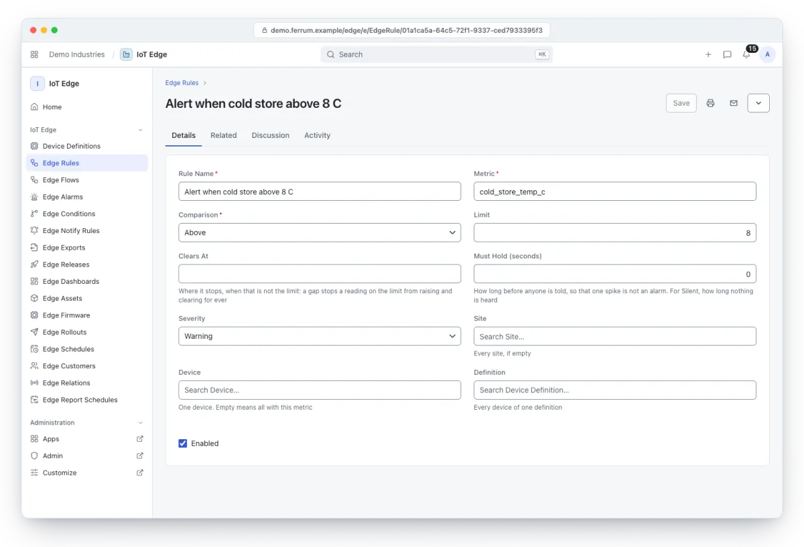
</picture>

<p align="center"><b>🔎 One rule</b><br><sub>Read and edit one edge rule, with its history and related records.</sub></p>

<table>
<tr>
<td width="50%" valign="top">
<picture><source media="(prefers-color-scheme: dark)" srcset="docs/assets/screens/edge-edge-rule-list-dark.webp">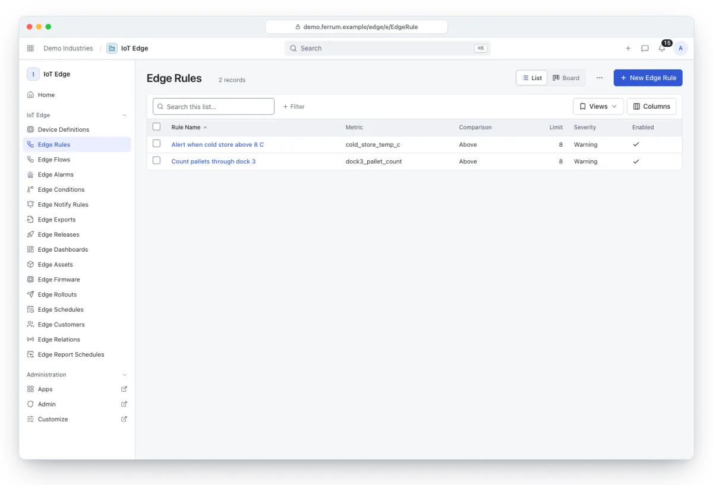</picture>
<p><b>📏 Edge rules</b><br><sub>Browse, search and filter the rules that watch a number at the edge and raise alarms.</sub></p>
</td>
<td width="50%" valign="top">
<picture><source media="(prefers-color-scheme: dark)" srcset="docs/assets/screens/edge-device-definition-list-dark.webp">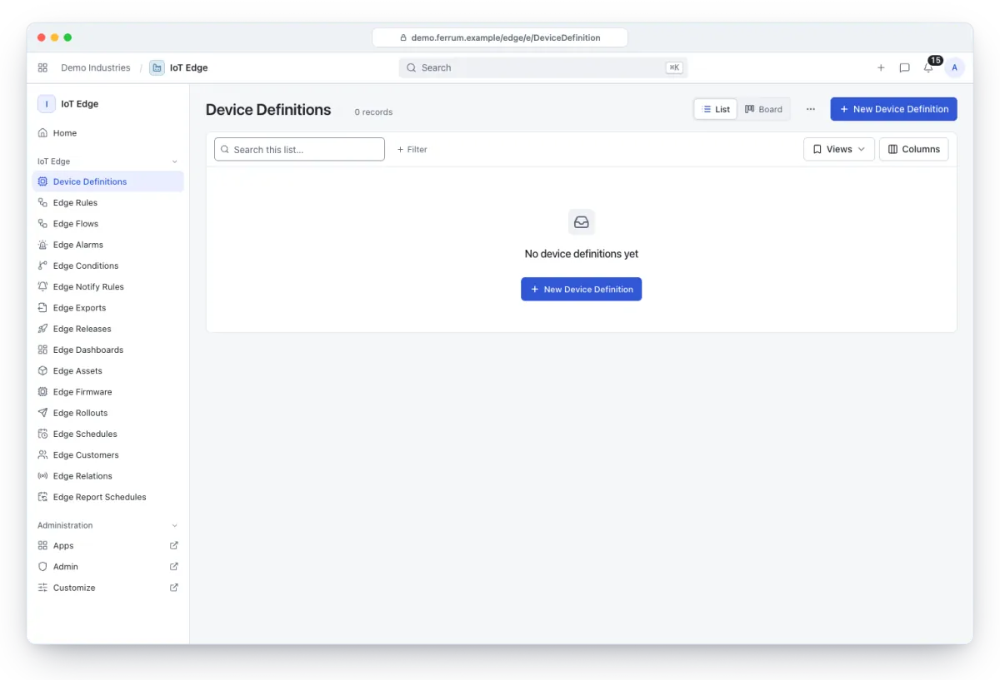</picture>
<p><b>📝 Device definitions</b><br><sub>Browse, search and filter the definitions that say how each kind of device is reached and read.</sub></p>
</td>
</tr>
<tr>
<td width="50%" valign="top">
<picture><source media="(prefers-color-scheme: dark)" srcset="docs/assets/screens/edge-edge-alarm-list-dark.webp">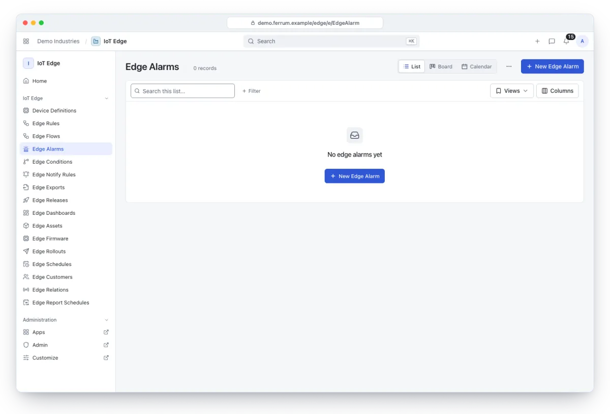</picture>
<p><b>🚨 Alarms</b><br><sub>Browse, search and filter alarms by severity and status.</sub></p>
</td>
<td width="50%" valign="top">
<picture><source media="(prefers-color-scheme: dark)" srcset="docs/assets/screens/edge-home-dark.webp">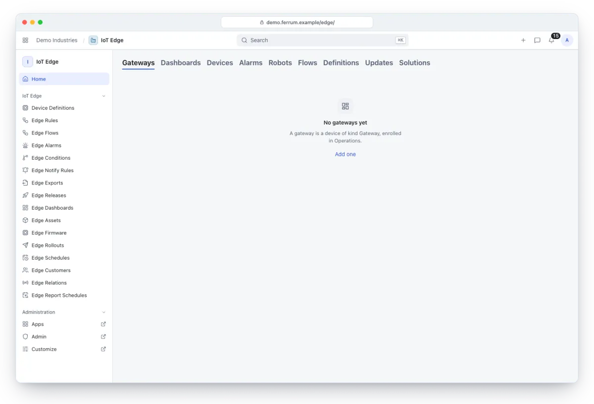</picture>
<p><b>🏭 IoT Edge home</b><br><sub>See gateways, dashboards, devices, alarms, robots, flows, definitions, updates and solutions as tabs on one page.</sub></p>
</td>
</tr>
</table>

<p align="center">
<picture><source media="(prefers-color-scheme: dark)" srcset="docs/assets/screens/edge-home-phone-dark.webp">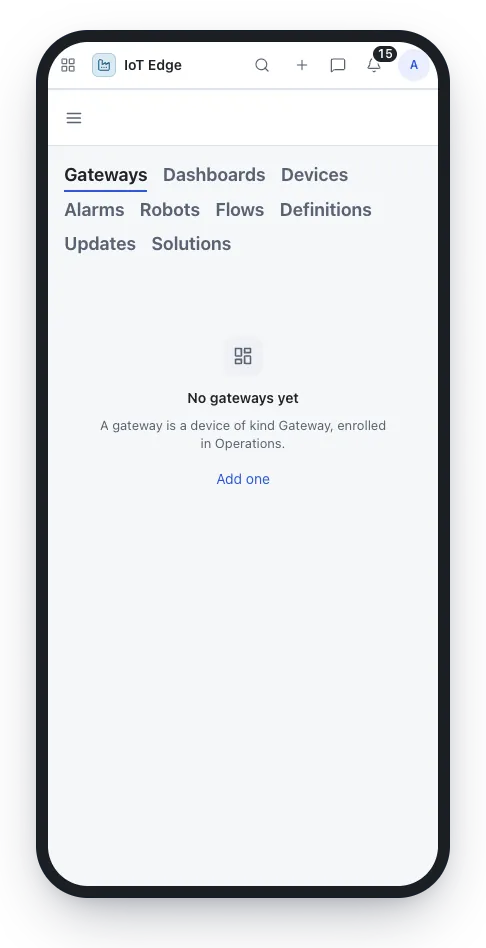</picture>
&nbsp;&nbsp;
<picture><source media="(prefers-color-scheme: dark)" srcset="docs/assets/screens/edge-edge-rule-list-phone-dark.webp">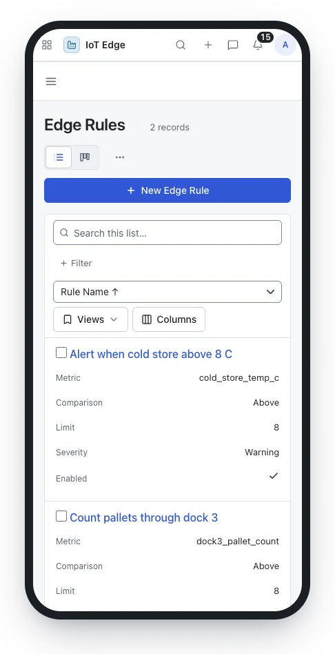</picture>
</p>

<p align="center"><b>📱 On a phone</b><br><sub>The home page and the rules list on a narrow screen.</sub></p>

> [!TIP]
> The screenshots follow your GitHub theme: switch between light and dark to see both. They show a workspace with no gateway enrolled yet; the dashboards, flow canvas and robot map fill in once devices report.


### 🏭 With a sample plant connected

These come from an earlier build (2 Nov 2026) on a workspace with a simulated plant: gateways, devices, a running flow and a dashboard. The interface has been restyled since, but every screen is still there.

<table>
<tr>
<td width="50%" valign="top">
<picture><source media="(prefers-color-scheme: dark)" srcset="docs/assets/edge-home-dark.webp">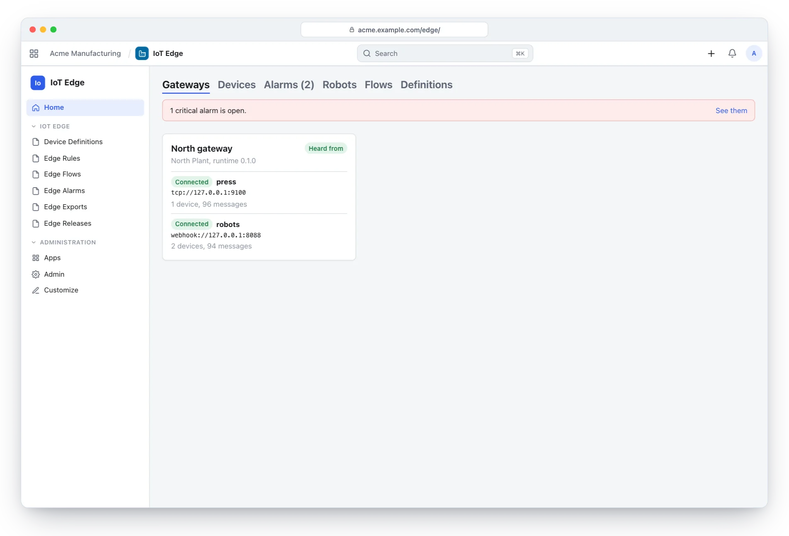</picture>
<p><b>🏠 Overview</b><br><sub>The overview: gateways, what they reach, how the fleet stands and what needs a person.</sub></p>
</td>
<td width="50%" valign="top">
<picture><source media="(prefers-color-scheme: dark)" srcset="docs/assets/edge-board-dark.webp">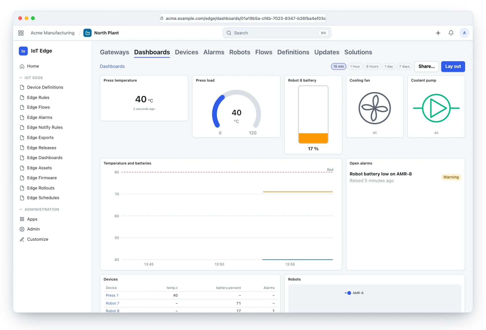</picture>
<p><b>📟 A dashboard</b><br><sub>Gauges, charts, alarms and controls, laid out by hand, with commands going through the ledger.</sub></p>
</td>
</tr>
<tr>
<td width="50%" valign="top">
<picture><source media="(prefers-color-scheme: dark)" srcset="docs/assets/edge-flow-dark.webp">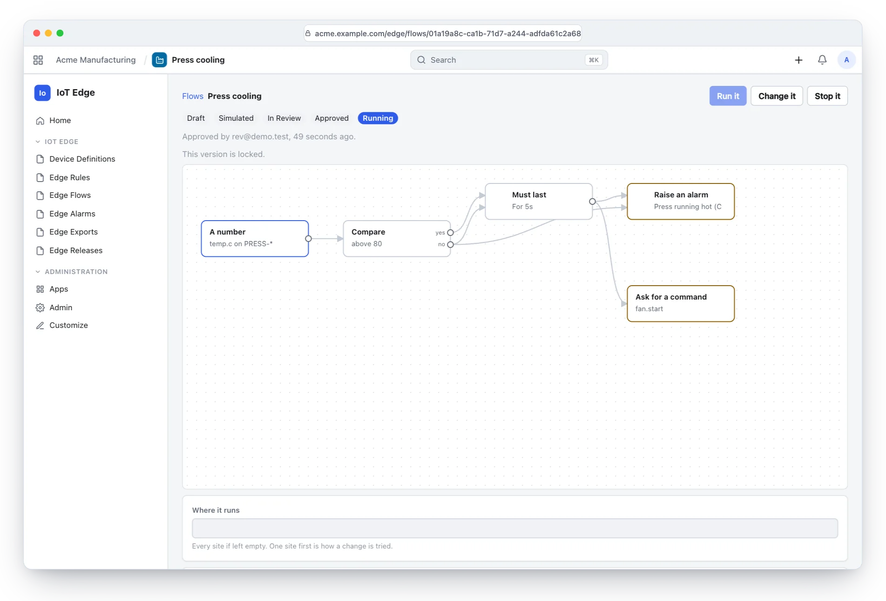</picture>
<p><b>🔀 A flow</b><br><sub>Logic drawn as steps and wires, simulated and reviewed, and watched live while it runs at the gateway.</sub></p>
</td>
<td width="50%" valign="top">
<picture><source media="(prefers-color-scheme: dark)" srcset="docs/assets/edge-devices-dark.webp">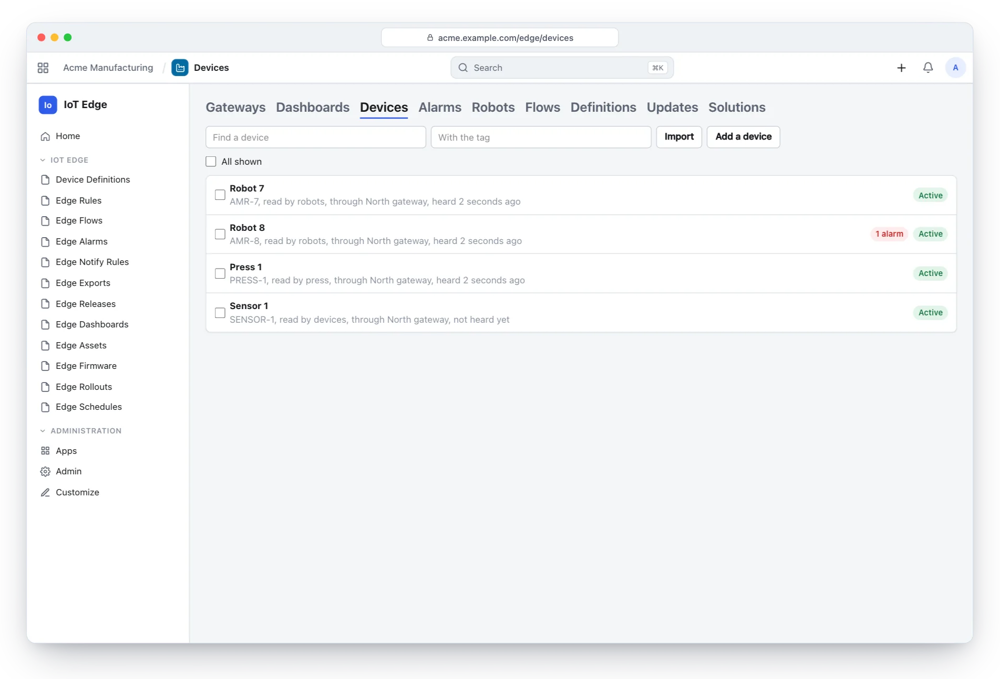</picture>
<p><b>🔌 Devices</b><br><sub>Found by tag and site, imported from a file, and asked for something all at once.</sub></p>
</td>
</tr>
<tr>
<td width="50%" valign="top">
<picture><source media="(prefers-color-scheme: dark)" srcset="docs/assets/edge-robots-dark.webp">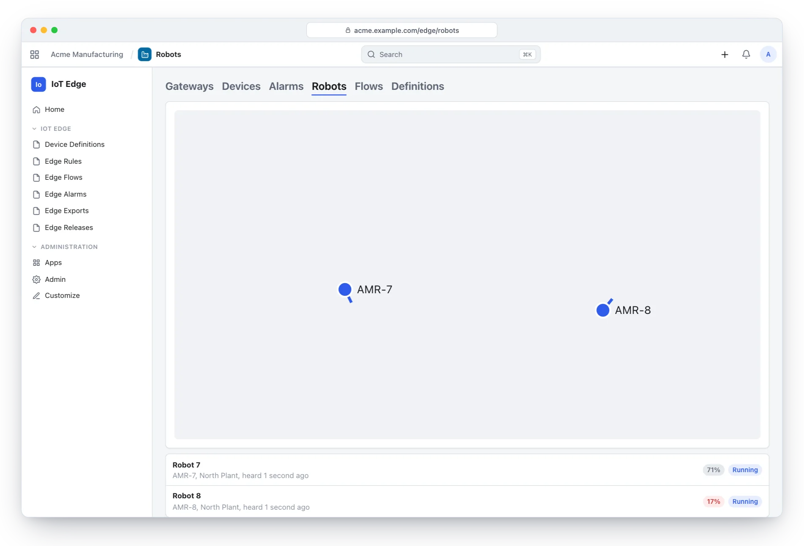</picture>
<p><b>🤖 Robots</b><br><sub>Where each one says it is, on a plan of the site.</sub></p>
</td>
<td width="50%" valign="top">
<picture><source media="(prefers-color-scheme: dark)" srcset="docs/assets/edge-definition-dark.webp">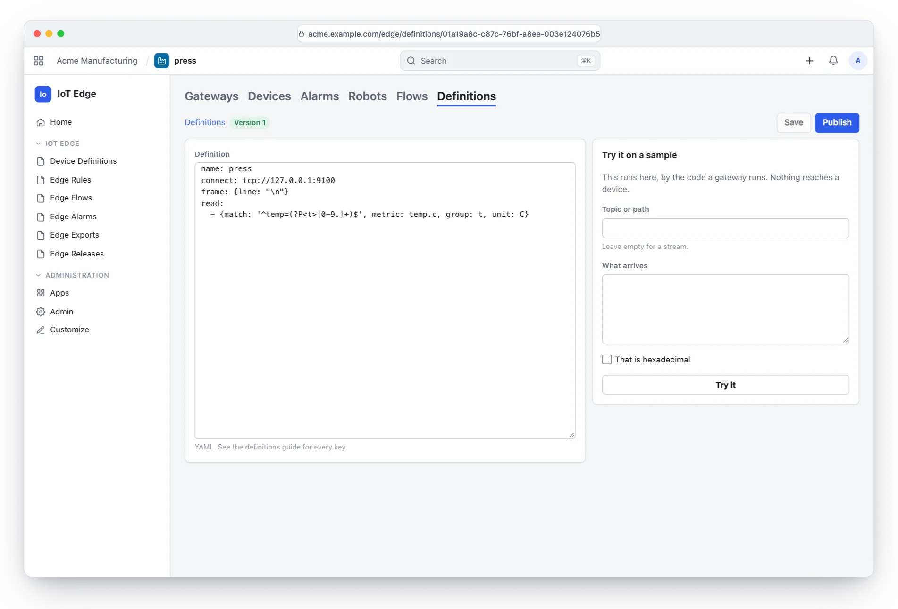</picture>
<p><b>📄 A definition</b><br><sub>A device in a few lines, tried on a sample with nothing attached.</sub></p>
</td>
</tr>
</table>

## ✨ Features

### 📝 Devices as data

- **Device Definition.** A kind of device described as YAML: how it is reached (`connect`), how a stream is cut into messages (`frame`), what to ask (`poll`), how to read it (`read` with regular expressions, JSON paths, binary formats, many values at once), numbers worked out from others (`derive`), and commands with how their status is read. Draft or Published; gateways run only the published body, so a draft cannot break anything.
- **Reached over.** `tcp`, `udp`, serial (baud, parity, stop bits), HTTP polling, WebSocket, MQTT, listeners, SQL (PostgreSQL and SQLite, read only), FTP and watched folders, NATS, Kafka and AMQP as sources, and webhooks.
- **Industrial protocols with a line per thing to read.** Siemens S7, EtherNet/IP (Logix tags), TwinCAT ADS, BACnet/IP (with Who-Is), OPC UA (watch, read, write, call, events, conditions, history, browse, encryption and users), Modbus TCP and RTU, SNMP v1, v2c and v3 with traps, KNX over IP, IEC 60870-5-104, DNP3, DLMS/COSEM, M-Bus, MTConnect and Sparkplug B.
- **Anything else is an external driver.** A process in any language that speaks JSON lines, run only from the gateway's `drivers_dir`. Two examples ship: `drivers/can_bridge.py` and `drivers/ble_bridge.py`.
- **Try it with nothing attached.** A definition is tried on a sample before it is published; a flow's simulation is required before review.
- **Secrets stay on the site.** `{secret.x}` in a definition is filled from the gateway's own `secrets`, and a failure never quotes an address that might hold one.
- **49 templates.** From `modbus-tcp-plc` and `s7-plc` to `vda5050-3`, `open-rmf`, `opentcs`, `rosbridge`, `mir-rest`, `ur-dashboard`, `chirpstack-lorawan`, `ttn-webhook`, `sigfox-callback`, `zigbee2mqtt`, `ocpp-chargers`, `lwm2m-devices` and more. A template is a start, not a promise: none has been tried on the equipment it names.

### 📡 Devices that call in

- **ThingsBoard's own device API.** MQTT 3.1, 3.1.1 and 5, HTTP and CoAP (with Observe and blocks), on the same topics and paths, so ThingsBoard's client libraries work unchanged.
- **Gateway API for devices behind a device** (`v1/gateway/*`), tried with ThingsBoard's own gateway client.
- **Credentials.** Access tokens, basic MQTT credentials and X.509 certificates. Only hashes reach a gateway.
- **Provisioning and claiming.** Devices can provision by a shared key (they report but take no command until commissioned) and be claimed by a secret they hold. Import devices in bulk from CSV, each with a token shown once.
- **Device RPC.** A device that asks the gateway something raises an event a flow can answer, so a device that wants the time, a limit or a setting needs no platform.
- **LwM2M** over plain UDP and DTLS by pre-shared key; **OCPP 1.6-J and 2.0.1** for EV chargers with security profiles 0 to 3.
- **Charging sessions.** A session is worked out again from everything said about it, whatever order it arrived in. It counts as charging only once a register has moved; a reset, late, missing or unverified reading gives no figure to bill on, and only a person can settle such a session, with a reason that stays on it. Charger and MQTT ports pace new connections at 100 a second unless set otherwise.
- **DTLS** for what leaves a private network.

### 🔀 Flows

- **A canvas of 44 kinds of step.** When (a number, a state change, an event, an attribute, a timer), decide (compare, in range, must last, gone quiet, only changes, not too often, wait, count, average, calculate, combine, remember, translate, choose by value, how far it went, in a place, unlike the rest, and more), and do (raise an alarm, tell someone, ask for a command, record an event or a number, set an attribute, send elsewhere, answer the device, write to the log, open a case).
- **No code, no loops.** A step of an unknown kind, a field it does not take, or a cycle is refused when the flow is read. Formulas are exact decimal arithmetic with `round`, `abs`, `min`, `max` and `coalesce`, with no clock or random number.
- **Draft, simulated, in review, approved, running.** An author simulates the flow by the code a gateway runs; a different person approves it; it runs at one site first or at all of them. A new version needs simulating again. Stopping is never a question of review.
- **Watch it run.** Real messages at each step, with device, value and the way they left. Off until an Edge Engineer turns it on, stops by itself after ten minutes (an hour at most), and is kept for an hour.
- **Version history, export and import.** Every version that ran is kept; *Draw from this* puts an old one on the canvas, to be reviewed again. A flow downloaded and started elsewhere begins as a draft.
- **Sub-flows.** *Way into this flow*, *way out of this flow* and *use a flow* copy an approved flow in, so what is simulated and run is the whole. If what it uses changes, it will not run until reviewed again.
- **At the gateway or on the platform.** At the gateway it works offline and remembers across restarts. On the platform it sees across sites, hears each closed minute, and cannot *answer the device* or *send elsewhere*.
- **Business-critical flows** (`profile: critical`). Each reading knows when it was seen and how far it can be trusted (bad readings arrive marked); a reading already seen changes nothing; where the flow stands and what it did are written in one transaction, so a power cut neither loses nor repeats a decision; and an *episode* step opens, holds, reopens and closes a condition with deadbands and delays. *Bring to units* scales exactly and quarantines what cannot be a reading, *average over the time seen* handles late and corrected readings, and *open a case* hands an episode to the platform.
- **Bounded.** A step remembers at most 5,000 devices and a flow 50,000 things; each one left out is said.

### 🛑 Commands go through the ledger

- **Asks, never acts.** The strongest thing a flow, schedule or rollout can do is ask for a command. It goes through Operations' ledger like a person's: the device must be commissioned for it, the site must hold authority, and it runs only under an approved envelope or when a person says.
- **Waiting requests expire.** With the link down a request waits; if it outlasts its `expires`, or its flow has been stopped, it is not issued and the device's history says why.
- **Checked again at the moment it goes.** Deadline, lease, authority, cancel, device and what it may do are all re-checked just before dispatch.
- **Unknown outcomes are for a person.** A crash, an address that changed under running work, or two different endings leave a command *unknown*; nothing resends it, and a person says what happened.
- **A flow is not a safety function.** Interlocks, emergency stops and collision avoidance stay with the equipment.

### 🚨 Alarms and notifications

- **Edge Rule.** Watches a number at the edge with a limit, a clear value, a hold time and a severity, for a site, a device or a definition. It raises an alarm and moves nothing.
- **Edge Alarm.** From raised to dealt with: acknowledge, clear, assign, comment, shelve. Severities are Critical and Major (red), Minor and Warning (amber), Info (blue); one the interface does not know is amber, never calm.
- **Edge Notify Rule.** Who is told about what, and how, in steps that wait (after N minutes, by channel, to a target). In-app, email and webhooks, durable, at least once. Dealing with an alarm stops the steps still to come.
- **Edge Condition.** One for each episode a business-critical flow saw, with what was seen meanwhile (last value, peak, unit, evidence count, stale). The platform publishes `edge.condition_opened`, `_reopened`, `_closed` and `_interrupted` once each, so a process the workspace runs starts once per episode.
- **Mobile push** by web push through the workspace's PWA, chosen by a person for alarms. There is no native app, and it has not been tried on a phone.
- **SMS and voice** by webhook to a provider.

### 📊 Dashboards and history

- **Edge Dashboard.** Widgets laid out on a grid by hand: value, gauge, level, state, symbol, line chart, bars, table, link, alarms, events, map, button, setpoint and text. Variables, drill-down between dashboards, and a small set of SCADA symbols.
- **Controls send commands through the ledger.** Buttons and setpoints ask; they never write to equipment directly.
- **Shared links.** A link shows only what was laid out and changes nothing; it reads by polling.
- **Live updates.** Pages hear on the platform's socket that a site's readings landed and ask again at once, paced to one ask in three seconds, with their reader's rights.
- **History.** Long ranges by rollup and short ones by sample, in partitions and rollups on PostgreSQL.
- **Robots.** Where each robot says it is, on a plan of the site.
- **Maps.** Where devices say they are.
- **Reports.** Device Availability, Alarm History and Readings by the Hour, to read and export, and sent by schedule.

### 🚚 Fleet at once

- **Devices page.** Search and tags; `GET /devices` also takes `site`, `definition`, `asset` and `related`. Each device shows when it was last heard and whether it is connected.
- **Edge Asset.** A thing that matters and is not a device, a building or a cold room. Assets sit inside each other, a device belongs to one, and an asset takes in everything under it.
- **Edge Relation.** Any way two devices belong together beyond what assets say (this pump feeds that tank). It shows on both devices and finds them for a bulk ask. It moves nothing.
- **Bulk commands and desired state.** Up to 500 devices at a time, each through the ledger as the person's own request. An empty selection is refused.
- **Edge Schedule.** Ask a site's, definition's or tag's devices for something every N minutes or at a time on given days, as automation under an envelope.
- **Firmware.** *Edge Firmware* says what a file is and its SHA-256. *Edge Rollout* takes it to devices a few at a time (`percent` of the fleet, `batch` at once), stopping by itself at `stop_after` failures. Only for devices of a definition that allows it, commissioned for `firmware.update`, of kind Sensor, Meter, Scanner or Station. **Never** a robot, a controller, a machine or a fleet. Devices fetch chunks over MQTT, HTTP or CoAP as ThingsBoard's clients expect.
- **Solutions.** Definitions, rules, flows and dashboards that go together. *Cold rooms* and *Energy meters* come with the app; *Download what is here* makes one to take elsewhere, with no exports, secrets or tokens. They install as drafts.
- **Allowances.** An operator can give a workspace limits (`measurements_per_day`, `devices`). Past the first, gateways hold readings within their own budget; commands and leases go on.

### 🤝 Customers of your own

- **Edge Customer.** Someone who owns devices, with the people who may look. Set *Owned By* on a device and *Customer* on a dashboard.
- **Portal.** Those people sign in to the workspace's portal and find **Your devices**: how each is doing, its readings and alarms, and the dashboards given to them, without controls. They can acknowledge an alarm, and it says who did. They cannot send a command, and a device of anyone else's is not there.
- **Entity views.** *Shows Its Customer* limits what a customer sees of a device, such as `temp.*, power`.

### 🔗 Exports and standards

- **Edge Export.** Where else a site's measurements go. Each keeps its own queue in the journal (up to 200,000 readings, oldest dropped and counted), delivers at least once in batches of 500, and takes a reading off the queue only when the far end said yes. An address with a password in it is refused.
- **Destinations.** Webhooks (signed batches), MQTT, NATS, Kafka, RabbitMQ and other AMQP 0-9-1, InfluxDB 2 and 3, ClickHouse, a table of your own in PostgreSQL, S3 (and anything that speaks S3), SQS, SNS, Google Pub/Sub, Azure IoT Hub and Event Hubs, and Sparkplug B (the gateway as an edge node).
- **The gateway as an OPC UA server.** Read only, each device a folder and each metric a variable, with encryption, a login and certificates a person trusts.
- **Twins and standards.** Reported and desired state, W3C Thing Description, Asset Administration Shell (the output validates against the official schema; the repository is served read only) and GS1 EPCIS 2.0 object events.
- **Peers and relays.** A box in a cabinet works through the site's server over a signed link; a relay passes a closed network's requests on to the server and can forge nothing.

### 🏭 The gateway, `ferrum-site`

- **One static binary,** a SQLite journal, no broker of its own. Equipment that needs a broker gets Mosquitto beside it, so a fault in one leaves the other standing.
- **Offline.** It keeps reading, running flows, raising alarms and dispatching the commands it already holds within its lease. It does not originate new work: a flow's request becomes a command only on the platform.
- **Recovery.** After a crash it asks the device each command went to, and no other. What it cannot answer is *unknown*, never resent.
- **Time.** Deadlines and leases use the platform's time on a clock nothing on the machine can set. After a reboot no new work starts until the platform answers or a person with the *recover* right vouches at the console. `clock_drift_ppm` (100 by default) keeps a slow crystal from stretching a lease.
- **Disk.** It keeps a telemetry budget (1,024 MB by default) and a reserve (256 MB); below the reserve it starts nothing new and sheds telemetry first, counted not hidden.
- **Backup and restore.** A backup is consistent while running. After a restore, dispatch stays off until a person has settled every unknown outcome. Old epochs and signatures are refused.
- **Self-update.** Signed releases, staged by an *Edge Release*, taken only if a key the gateway was installed with signed them, not expired and newer. A new build that keeps dying before it speaks is put back and refused from then on. CI holds no signing key.
- **Console.** Work, links and problems, plus floor reports by run number, signed in with a PIN set in Operations, and `/metrics`. It also draws the last 120 readings of up to 200 series.
- **Allow list.** `allow` limits what hosts definitions, exports, firmware and updates may reach, redirects included.
- **Authority moves by a person.** Replacing a gateway needs a person to move authority; the old one is fenced by an epoch. A suspected stolen key is quarantined in Operations.

### 🔐 Roles and privacy

| Role | What it can do | Entities |
|---|---|:-:|
| **Edge Viewer** | Sees gateways, devices, alarms and robots | 18 |
| **Edge Engineer** | Writes and publishes definitions, rules, flows and exports, runs the fleet, and acknowledges alarms | 21 |
| **Edge Reviewer** | Reviews flows drawn by others, and decides when they run | 9 |

- **Personal-data requests.** Customers' people and report recipients are found by their address in their rows; erasure removes those rows and leaves the customer and the schedule.
- **Audit.** Each flow step through approval is in the audit trail; commands carry who asked.
- **Support report.** The workspace's support report counts gateways in service that have spoken, those not heard from for five minutes, and those whose last word named problems, as counts only, so a partner or the control plane sees how they are and nothing else.
- **Assistant.** Ferrum's assistant knows the states of definitions, flows, alarms and rollouts, and suggests "Which alarms are active now?", "Which rollouts are running?" and "Which flows are waiting for review?".

## 🧭 How it works

### From equipment to Ferrum

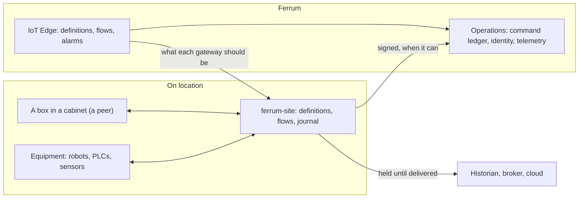

A gateway reads equipment, decides and keeps what it saw in its journal. It reaches the platform when it can, and what it was asked to do waits for the platform's ledger.

### A flow, from drawing to a command

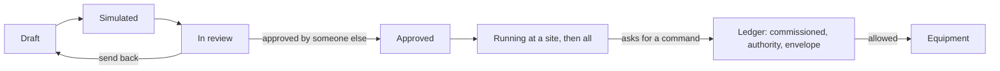

Nothing a flow can say reaches equipment except as a request the ledger decides.

## 🧱 Data model

### Entities

| Entity | What it is | Key fields or states |
|---|---|---|
| Device Definition | How a kind of device is reached, read and commanded | name, Draft / Published, revision, body, published body |
| Edge Rule | Watches a number at the edge | metric, comparison, limit, clear value, hold, severity |
| Edge Flow | Logic drawn as a flow | Draft / In Review / Approved, live, runs at, site, simulated digest, approved by |
| Edge Alarm | A rule or flow that fired | severity, status, assignee, shelved until, value, raised at |
| Edge Condition | A sustained episode from a critical flow | episode, status, opened and closed at, peak, stale |
| Edge Export | Where a site's measurements also go | send to, topic, metrics, sign with |
| Edge Release | A signed build of the gateway | version, URL, SHA-256, signature, expiry, percent |
| Edge Dashboard | Widgets on a grid | body, shared link, customer |
| Edge Notify Rule | Who is told, in waiting steps | trigger, minimum severity, steps |
| Edge Asset | A thing that is not a device | type, parent, site |
| Edge Firmware | A firmware file for a kind of device | version, definition, URL, SHA-256, size |
| Edge Rollout | Firmware to devices a few at a time | Draft / Running / Paused / Done, percent, batch, stop after |
| Edge Schedule | Ask devices by the clock | every N minutes or at a time, days, operation, payload |
| Edge Customer | Someone who owns devices | people |
| Edge Relation | How two devices belong together | from, relation, to |
| Edge Report Schedule | A report sent by itself | report, format, time, days, recipients |
| Notify Step, Customer Person, Report Recipient | Child rows | |

Fields added to Operations' *Device*: definition, address, settings, concurrency, MQTT client and user, certificate fingerprint, reached through, owned by, shows its customer, tags and belongs to.

### Reports and upkeep

Device Availability, Alarm History and Readings by the Hour. Upkeep watches gateways, sends notifications that are due, runs flows that run on the platform, advances firmware rollouts, delivers scheduled reports, and clears events older than 90 days and flow traces older than an hour.

### Simplified entity relations

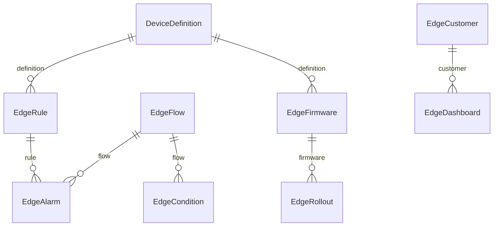

## 🔌 Integrations

| With | How | Needs |
|---|---|---|
| Operations | The command ledger, identity, sites and telemetry. IoT Edge adds fields to its devices | Operations `>=0.1` |
| Workspace portal | A customer's *Your devices* page | Portal people on an Edge Customer |
| Control Plane | Gateways count in a workspace's health | The server's support report |
| Studio and Solutions | A process starts on *Edge condition opened* | Nothing extra |
| ThingsBoard clients | Device, gateway and firmware APIs, unchanged | Nothing |
| MQTT, HTTP, CoAP, LwM2M, OCPP | Devices that call in | Reachable ports on the gateway |
| OPC UA, Modbus, S7, EtherNet/IP, ADS, BACnet, SNMP, KNX, IEC 104, DNP3, DLMS, M-Bus, MTConnect, Sparkplug B | Definitions | The equipment's address and, where it has them, credentials |
| NATS, Kafka, RabbitMQ, InfluxDB, ClickHouse, PostgreSQL, S3, SQS, SNS, Pub/Sub, Azure IoT Hub and Event Hubs | Exports | Each service's address and key; Google, Azure and AWS ones have not been sent to the real services |
| ChirpStack, The Things Stack, Sigfox, LORIOT, ThingPark, Zigbee2MQTT, AWS IoT Core | Templates over webhooks, MQTT and Kafka | The service's own account; none has met the service it names |
| VDA 5050, Open-RMF, openTCS, rosbridge, MiR, Universal Robots | Templates for robot fleets | A running system, which none has met |
| Mosquitto | A broker beside the gateway | `deploy/mosquitto.conf` as a start |
| Email and SMTP | Notification steps and scheduled reports | The workspace's mailer; PDF reports need the server's renderer, which has not been run |
| Web push | Alarm notices to a person's browser | The workspace's PWA |

## 📊 How it compares

The leaders are the cloud and industrial edge platforms: AWS IoT Greengrass with SiteWise, Azure IoT Operations, Siemens Industrial Edge and Litmus Edge, plus the open-source ThingsBoard and Node-RED. They are far ahead in field proof; IoT Edge's case is one platform with the business and a reviewed way of acting on equipment.

| Capability | Ferrum IoT Edge | Greengrass / SiteWise | Azure IoT Operations | Siemens Industrial Edge | Litmus Edge | ThingsBoard | Node-RED |
|---|:-:|:-:|:-:|:-:|:-:|:-:|:-:|
| A device described as data | ✅ | ❌ | ✅ | 🟡 | ✅ | 🟡 | ❌ |
| Wide industrial protocol set | ✅ | 🟡 | 🟡 | ✅ | ✅ | 🟡 | 🟡 |
| Proven on real production equipment | ❌ | ✅ | ✅ | ✅ | ✅ | ✅ | ✅ |
| Devices call in over MQTT, HTTP, CoAP | ✅ | 🟡 | 🟡 | 🟡 | 🟡 | ✅ | ✅ |
| Visual flow builder | ✅ | ❌ | 🟡 | ✅ | ✅ | ✅ | ✅ |
| Simulate, then second-person approval before a flow runs | ✅ | ❌ | ❌ | ❌ | ❌ | ❌ | ❌ |
| Custom code at the edge | ❌ | ✅ | 🟡 | ✅ | ✅ | ✅ | ✅ |
| Containers or apps at the edge | ❌ | ✅ | ✅ | ✅ | 🟡 | ❌ | ❌ |
| Works offline with local rules | ✅ | ✅ | ✅ | ✅ | ✅ | 🟡 | ✅ |
| Store and forward until delivered | ✅ | ✅ | 🟡 | 🟡 | ✅ | 🟡 | 🟡 |
| Commands pass an approval and audit ledger | ✅ | ❌ | ❌ | ❌ | ❌ | ❌ | ❌ |
| Alarms: assign, shelve, escalate | ✅ | ❌ | ❌ | 🟡 | 🟡 | ✅ | ❌ |
| Drag-and-drop dashboards | ✅ | 🟡 | 🟡 | 🟡 | 🟡 | ✅ | 🟡 |
| Customers own devices, with a portal | ✅ | ❌ | ❌ | ❌ | ❌ | ✅ | ❌ |
| Staged firmware rollouts to devices | ✅ | ✅ | 🟡 | ✅ | ✅ | ✅ | ❌ |
| Signed self-update of the edge software | ✅ | ✅ | 🟡 | ✅ | ✅ | 🟡 | ❌ |
| Exports to Kafka, NATS, AMQP, InfluxDB, ClickHouse, S3 | ✅ | 🟡 | 🟡 | 🟡 | ✅ | ✅ | ✅ |
| Machine learning at the edge | 🟡 | ✅ | 🟡 | ✅ | ✅ | 🟡 | 🟡 |
| Roles and audit trail | ✅ | ✅ | ✅ | ✅ | ✅ | ✅ | 🟡 |
| Scheduled reports by email | 🟡 | ❌ | ❌ | ❌ | ❌ | ✅ | ❌ |
| Native mobile app | ❌ | ❌ | ❌ | ❌ | ❌ | ✅ | ❌ |
| Hosted by the vendor | ❌ | ✅ | ✅ | ✅ | ✅ | ✅ | ❌ |
| Same data as maintenance, assets and accounting | ✅ | ❌ | ❌ | ❌ | ❌ | ❌ | ❌ |
| Open source and self-hosted | ✅ | ✅ | 🟡 | ❌ | ❌ | ✅ | ✅ |

Notes: 🟡 for Ferrum means partly or by an external driver (machine learning runs in an external driver; scheduled PDF reports need the server's renderer, which has not been run). 🟡 for a leader usually means through an extra component, a partner product or a community extension. Ferrum's "wide protocol set" is code tried against simulators and other people's libraries, not equipment: see the row below it. [docs/parity.md](docs/parity.md) holds the capability-by-capability record against the reference products, with a status for each (Verified, Built, Partly, By design, External, No).

### 🏆 Where IoT Edge stands out

- 🛑 **Reviewed logic and a ledger for commands.** Simulation, a second person's approval and an approval ledger sit between a drawing and equipment.
- 📴 **A journal that survives.** Crash points are killed on purpose in tests, and a mutation script breaks each guarantee in turn to check that a test notices.
- 🔗 **ThingsBoard's device API, unchanged.** Firmware that talks to ThingsBoard talks to a gateway.
- 🧱 **One platform.** Alarms become cases, assets are the business's assets, and customers see their devices in a portal.
- 📜 **An honest record.** Each protocol says what it was tried against and what was not.

### 🚧 Where the leaders are still ahead

- 🏭 **Field proof.** They run in production on real equipment; this has not.
- 🧰 **Code and containers at the edge.** Greengrass, Azure and Siemens run arbitrary workloads; here a flow has no code, by design.
- 🧠 **Machine learning** at the edge is built in at the leaders; here it arrives from an external driver.
- ☁️ **Managed service and certifications.** None is held here yet.
- 📱 **Native mobile apps** and a larger device library.

> [!NOTE]
> Leader columns are from public product information as of November 2026 and may change.

## 📍 Roadmap

### ✅ Recently shipped

- [x] **0.6.3** Rebuilt on the tuned design system: better menu icons, a lighter first page, a visible scroll cue, cleaner print.
- [x] **0.6.2** The redesigned interface: shaped loading, told-apart states, one severity colour on every screen.
- [x] **0.6.1** *Add what is known* takes `fresh`, so a site that lost its link does not take old readings for current ones; tests show no step moves equipment or reads a clock.
- [x] **0.6.0** Business-critical flows: trusted readings, decisions written in one transaction, episodes that become one case each.
- [x] **0.5.6** The assistant knows its records.
- [x] **0.5.0** Gateways in the workspace's support report, as counts.

### 🔜 Next up

- [ ] **First run on physical equipment.** Every protocol so far met only simulators and libraries. This is the largest gap.
- [ ] **Vendor simulator runs.** Rows in [compatibility](docs/compatibility.md) still say No for vendor simulators.
- [ ] **Certificates over DTLS** for CoAP and LwM2M, and LwM2M bootstrap.
- [ ] **BACnet COV.** It polls today.
- [ ] **DNP3 Secure Authentication, TLS and serial.**
- [ ] **A real run of the PDF report path.** Scheduled PDFs need the server's renderer and have not been run.
- [ ] **Web push tried on a phone.**
- [ ] **Many-gateway and long-run load.** One gateway measured 28,500 readings a second end to end on a laptop, with 37,000 the sustained limit; many gateways and long runs are not measured.

### 🔭 Later

**Protocols**
- [ ] DLMS over HDLC, high-level security and ciphering.
- [ ] A Kafka reader with consumer groups (it keeps its place in a file today).
- [ ] OPC UA server history.
- [ ] Sparkplug B datasets and templates, and a run against another host or node.
- [ ] SNMP informs on v3.
- [ ] An EtherNet/IP I/O connection (left out on purpose today).

**Standards and twins**
- [ ] Writing through the Asset Administration Shell repository, tried with an AAS client.
- [ ] An EPCIS repository and capture interface.
- [ ] Platforms sharing a view (federation beyond export and peers).

**Dashboards and operations**
- [ ] A drawing tool for new SCADA symbols.
- [ ] A screen designer for local dashboards at the gateway.
- [ ] An ONNX runtime built into the gateway.
- [ ] A native mobile app.
- [ ] Exports to AWS, Google and Azure confirmed against the real services.
- [ ] Vendor qualification labels (Community, Security-reviewed, Operationally verified, Vendor-qualified): none is held yet.

**By design, not planned**
- Code in a flow, loops, flows acting directly on equipment, AI deciding about equipment, containers at the edge, automatic failover, ROS 2 over DDS directly, motion control and safety functions.

## 🚀 Install

IoT Edge ships in the official Ferrum server image. A workspace administrator installs it from **Apps** (`/store/`); it needs **Operations** (`ops`) `>=0.1` installed first. Self-hosters building their own image enable the `edge` feature of the server. Everything it adds is also available to AI agents over Ferrum's MCP server, within each person's permissions.

First steps in the app:

1. Give people **Edge Viewer**, **Edge Engineer** or **Edge Reviewer** (keep the reviewer a different person from the author).
2. In Operations, add the site, add the gateway as a device of kind Gateway, claim it and choose **Enroll a key** for a one-time code.
3. On the gateway: take `ferrum-site` from [the releases](https://github.com/CBFerrum/ferrum-app-edge/releases) for its architecture (`x86_64` or `aarch64`), check the hash, install it, then `ferrum-site enroll --config /etc/ferrum-site/site.yaml --code <code>` and start the service. It is static and needs only 64-bit Linux.
4. Commission it and put it in service, then add devices with a definition (start from a template).

[Running a gateway](docs/gateway.md) has installing, enrolling, backing up, updating, boxes in cabinets, closed networks and exports. `deploy/` holds the systemd unit, a starting `site.yaml` and a Mosquitto configuration.

| Guide | What it covers |
|---|---|
| [Running a gateway](docs/gateway.md) | Installing, enrolling, backing up, updating, boxes in cabinets, closed networks, exports |
| [Definitions](docs/definitions.md) | Describing a device |
| [Flows](docs/flows.md) | Drawing logic that runs at the gateway |
| [Looking after a fleet](docs/fleet.md) | Importing, asking many at once, firmware, schedules, solutions |
| [Parity](docs/parity.md) | What ThingsBoard and the rest do, capability by capability, and where this stands |
| [Compatibility](docs/compatibility.md) | What was tried on what, and what was not |
| [Licenses](docs/licenses.md), [accepted advisories](docs/advisories.yaml) | What a gateway compiles in, and what was reviewed |

## 🔧 Develop

Clone it next to the platform:

```text
work/
├── ferrum/            https://github.com/CBFerrum/Ferrum (with Ferrum-Frontend cloned into ferrum/web)
└── ferrum-app-edge/
```

Point the platform dependencies at your checkout (this file is git-ignored):

```toml
# .cargo/config.toml
[patch."https://github.com/CBFerrum/Ferrum"]
ferrum-calc = { path = "../ferrum/crates/calc" }
ferrum-domain = { path = "../ferrum/crates/domain" }
ferrum-kernel = { path = "../ferrum/crates/kernel" }
ferrum-meta = { path = "../ferrum/crates/meta" }
ferrum-ops = { path = "../ferrum/crates/ops" }
ferrum-ops-contract = { path = "../ferrum/crates/ops-contract" }
```

The tests need PostgreSQL with an ordinary (non-superuser) role, so row-level security applies:

```bash
createuser ferrum --pwprompt && createdb -O ferrum ferrum_edge_test
cargo test
```

The gateway's recovery test kills the real binary at named points, which takes a second database and a build that can crash on purpose. `scripts/mutants.py` then breaks each guarantee in turn, to check that a test notices.

```bash
createdb -O ferrum ferrum_site_test
cargo test -p ferrum-site --features failpoints --test recovery_it
```

CI creates both databases and, for the tests that meet other people's software, starts real services and installs clients: NATS, RabbitMQ, Kafka, InfluxDB, ClickHouse and moto (a stand-in for AWS), ThingsBoard's Python MQTT client, `ocpp`, `asyncua`, `pymodbus`, `mqtt-spb-wrapper` and Eclipse Leshan's demo client. It runs `cargo fmt --all -- --check`, `cargo clippy --workspace --all-targets -- -D warnings`, `cargo test --workspace`, the two failpoint test suites (`recovery_it`, `charger_it`), RustSec advisories (`cargo audit`), a check that every accepted advisory has an owner and a review date, and a license check of everything compiled in. A second, frozen run uses the exact lockfile and frontend a release is built from.

The interface lives in `ui/` and builds with Ferrum-Frontend's packages:

```bash
cd ui
npm run build      # ui/dist, checked against the size budget
npm test
```

With a development server started with `FERRUM_DEV_UI=1`, `ferrum-app dev --ui` serves the pages from Vite behind the real bar and session, with hot reload.

### 🚢 Releasing a gateway

Tag the repository with the version in `Cargo.toml`. CI builds `ferrum-site` for 64-bit Intel and ARM Linux, starts each on Ubuntu 22.04, Debian 12, CentOS 7 and Alpine with `scripts/starts.sh`, runs the gateway's tests on the C library it ships with, and only then attaches the files with their hashes to a GitHub release. CI holds no signing key: a person signs with `ferrum-site sign`, and the signature goes on the *Edge Release*.

## 📂 Project layout

```text
app.yaml      the manifest: id, version, requirements, what it adds to Ferrum
packages/     metadata: entities, roles, reports, events, SQL migrations
src/          the app's logic in Rust: alarms, charging, firmware, fleet, flows on the platform, portal, reports, schedules, twins
ui/           its own interface (React + Vite), built into ui/dist
tests/        integration tests against a real PostgreSQL
contract/     ferrum-edge-contract: definitions, flows and Sparkplug, pure code a simulation and a gateway share
gateway/      ferrum-site, the gateway: journal, transports, flows, links between servers, a console
templates/    the 49 definitions to start from
solutions/    Cold rooms and Energy meters
drivers/      two external drivers: CAN and Bluetooth Low Energy
deploy/       the systemd unit, a starting configuration, Mosquitto beside the gateway
docs/         guides, what was tried on what, licenses and accepted advisories
scripts/      mutants, the license inventory, the advisory check, soak and qualification helpers
CHANGELOG.md  what changed in each version
```

## 📜 Changelog

Every version is in [CHANGELOG.md](CHANGELOG.md).

## 🤝 Contributing

Issues and pull requests are welcome at [github.com/CBFerrum/ferrum-app-edge/issues](https://github.com/CBFerrum/ferrum-app-edge/issues). Run `cargo fmt --all`, `cargo clippy --workspace --all-targets -- -D warnings` and `cargo test --workspace` before sending a change, and say which equipment or software a protocol change was tried against.

## 📄 License

[AGPL-3.0-or-later](LICENSE), like the platform.

<div align="center">

<sub>Part of <a href="https://github.com/CBFerrum/Ferrum">Ferrum</a>, the open business platform · Made with 🦀 Rust and 🐘 PostgreSQL</sub>

</div>
