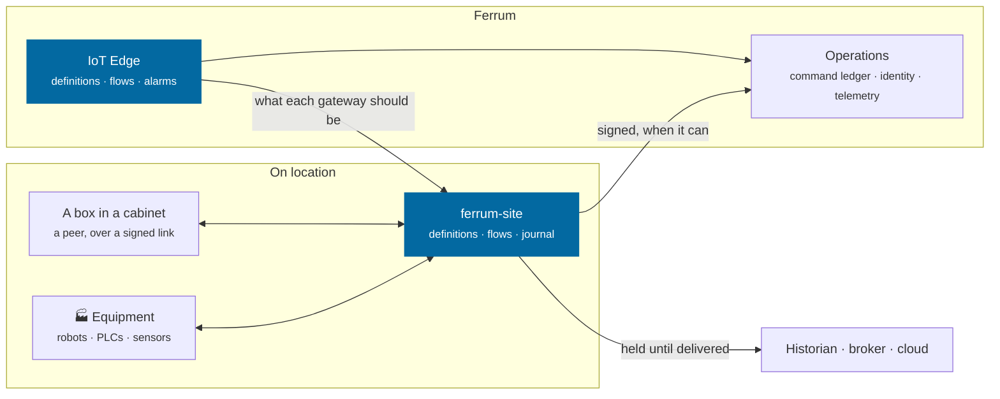
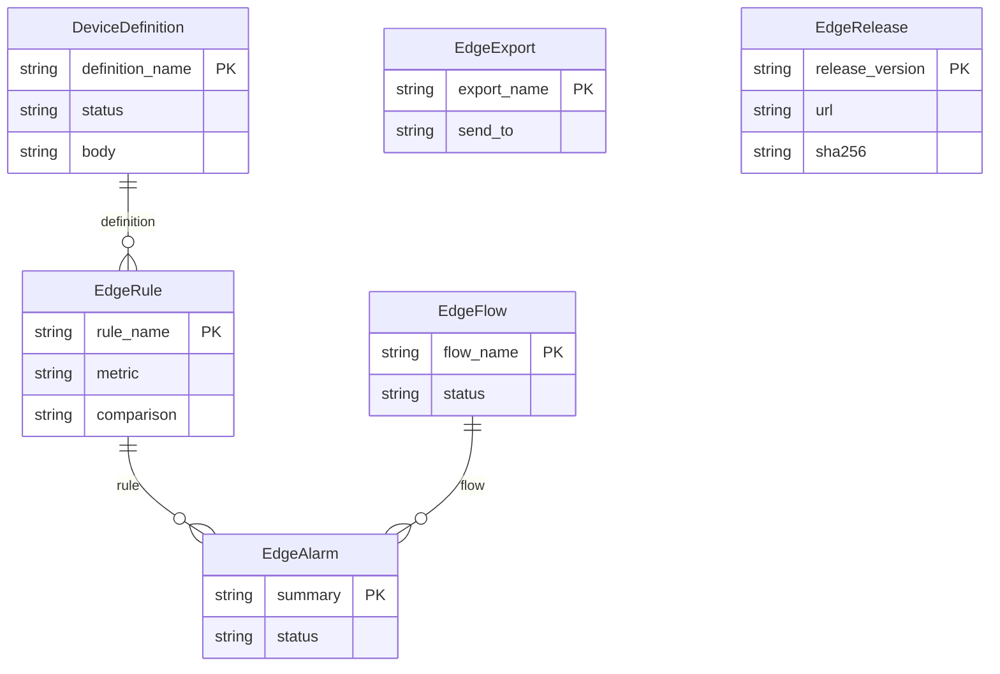

<div align="center">

<picture>
  <source media="(prefers-color-scheme: dark)" srcset="docs/assets/banner-dark.svg">
  
</picture>

[](https://github.com/CBFerrum/ferrum-app-edge/actions/workflows/ci.yml)      

**A native app for [Ferrum](https://github.com/CBFerrum/Ferrum), the open-source, AI-first business platform.**

[Overview](#overview) · [Highlights](#highlights) · [Screenshots](#screenshots) · [How it works](#how-it-works) · [The gateway](#the-gateway) · [Data model](#data-model) · [Install](#install) · [Develop](#develop) · [Changelog](#changelog)

</div>

---

## Overview

Ferrum IoT Edge connects equipment to Ferrum without writing a driver. A device is described in
a few lines of YAML: how to reach it, how to read it and how to command it. Those definitions run on
`ferrum-site`, the gateway in this repository, which reads, decides and keeps working on location
through outages and power cuts, and catches up when the link returns. Logic is drawn on a canvas,
simulated, and reviewed by a second person before it runs at the gateway. The strongest thing a flow
can do is ask for a command, and Ferrum's ledger decides whether it goes out.

Ferrum coordinates equipment and does not control it. Motion, machine sequencing and every safety
function stay with their own controllers.


| At a glance | |
|---|---|
| 📦 Version | `0.1.0` |
| 🧱 Platform | Ferrum `>=0.3, <0.4` |
| 🔗 Requires | ops `>=0.1` |
| 🖥️ Interface | its own, at `/edge/` |
| 🗃️ Records | 6 entities in 1 package |
| 👥 Roles | 3: Edge Viewer, Edge Engineer, Edge Reviewer |
| 📊 Reports | 0 |
| 🧪 Tests | 114 Rust tests, 2 interface test files |


> [!IMPORTANT]
> **Nothing here has run on physical equipment.** Every protocol was tried against simulators, stand-ins and other people's libraries, and no vendor's device, robot or PLC has been connected. Nothing is certified, and nothing here is a safety claim. [Compatibility](docs/compatibility.md) records what was tried on what, and what was not.


## Highlights

<table>
<tr>
<td width="50%" valign="top">

### 📝 Devices as data
TCP, UDP, serial, HTTP, WebSocket, MQTT, Modbus TCP and RTU and OPC UA need no code, nor do Sparkplug B and MTConnect. Anything else runs as a driver in any language.

</td>
<td width="50%" valign="top">

### 🧩 Twenty templates
VDA 5050, Open-RMF, openTCS, ROS 2 through rosbridge, MiR, Universal Robots and more, as starting points.

</td>
</tr>
<tr>
<td width="50%" valign="top">

### 🧪 Tried at a desk
A definition is checked when saved, tried on a sample with no device attached, and reaches gateways only when published.

</td>
<td width="50%" valign="top">

### 🔀 Flows
A canvas of 29 kinds of step, with no code and no loops, simulated by the code a gateway runs and approved by someone else.

</td>
</tr>
<tr>
<td width="50%" valign="top">

### 🛑 Asks, never acts
A flow can ask the ledger for a command. An approved automation rule or a person decides, so nothing on a canvas moves equipment by itself.

</td>
<td width="50%" valign="top">

### 📴 Works offline
Reading, deciding, alarms and commands carry on through outages, crashes and restores, from a journal on disk.

</td>
</tr>
<tr>
<td width="50%" valign="top">

### 🔗 Server to server
Boxes in cabinets over signed links, a relay out of a closed network, exports held until delivered, webhooks, signed updates with rollback.

</td>
<td width="50%" valign="top">

### 🤖 Robots and alarms
Where each robot says it is, on a plan of the site, and alarms that raise at the edge and come back to be acknowledged.

</td>
</tr>
</table>

## Screenshots

<picture>
  <source media="(prefers-color-scheme: dark)" srcset="docs/assets/edge-home-dark.webp">
  
</picture>

<p align="center"><sub>The overview: gateways, what they reach and what needs a person.</sub></p>

<picture>
  <source media="(prefers-color-scheme: dark)" srcset="docs/assets/edge-flow-dark.webp">
  
</picture>

<p align="center"><sub>A flow: logic drawn as steps and wires, simulated and reviewed before it runs at the gateway.</sub></p>

<picture>
  <source media="(prefers-color-scheme: dark)" srcset="docs/assets/edge-robots-dark.webp">
  
</picture>

<p align="center"><sub>Robots: where each one says it is, on a plan of the site.</sub></p>

<picture>
  <source media="(prefers-color-scheme: dark)" srcset="docs/assets/edge-definition-dark.webp">
  
</picture>

<p align="center"><sub>A definition: a device in a few lines, tried on a sample with nothing attached.</sub></p>

> [!TIP]
> The screenshots follow your GitHub theme: switch between light and dark to see both.

## How it works

### From equipment to Ferrum



### Inside Ferrum


Everything IoT Edge adds is ordinary Ferrum metadata and Rust: its records get lists, forms,
search, permissions, an audit trail, exports and the REST and MCP APIs for free, so AI agents work
with them under the same rules as people.

### What it adds to Ferrum

| Where | What |
|---|---|
| 🚀 Launcher | **IoT Edge** at `/edge/` |
| ➕ Create menu | Device definition |
| ➕ Create menu | Flow |

## The gateway

`ferrum-site` is one binary with a SQLite journal, and no broker of its own. Equipment that needs one
gets Mosquitto beside it, so that a fault in one leaves the other standing.

```bash
cargo build --release --locked -p ferrum-site
```

| Guide | |
|---|---|
| [Running a gateway](docs/gateway.md) | Installing, enrolling, backing up, updating, boxes in cabinets, closed networks, exports |
| [Definitions](docs/definitions.md) | Describing a device |
| [Flows](docs/flows.md) | Drawing logic that runs at the gateway |
| [Compatibility](docs/compatibility.md) | What was tried on what, and what was not |
| [Licenses](docs/licenses.md), [accepted advisories](docs/advisories.yaml) | What a gateway compiles in, and what was reviewed |

`deploy/` holds the systemd unit, a starting `site.yaml` and a Mosquitto configuration.

## Data model

The main records and how they connect (6 entities in all; `packages/` has every field).



### Roles

| Role | What it is for | Entities |
|---|---|---|
| **Edge Viewer** | Sees gateways, devices, alarms and robots. | 8 |
| **Edge Engineer** | Writes and publishes definitions, rules and exports, and acknowledges alarms. | 11 |
| **Edge Reviewer** | Reviews flows drawn by others, and decides when they run. | 7 |

## Install

Workspace administrators install it from **Apps** (`/store/`) in Ferrum; it ships in the
official Ferrum server image. It needs **ops** `>=0.1` installed first. Self-hosters building their own image enable the
`edge` feature of the server. Everything it adds is also available to AI agents over
Ferrum's MCP server, within each person's permissions.

## Develop

Clone it next to the platform:

```text
work/
├── ferrum/            https://github.com/CBFerrum/Ferrum (with Ferrum-Frontend cloned into ferrum/web)
└── ferrum-app-edge/
```

Point the platform dependencies at your checkout (this file is git-ignored):

```toml
# .cargo/config.toml
[patch."https://github.com/CBFerrum/Ferrum"]
ferrum-calc = { path = "../ferrum/crates/calc" }
ferrum-domain = { path = "../ferrum/crates/domain" }
ferrum-kernel = { path = "../ferrum/crates/kernel" }
ferrum-meta = { path = "../ferrum/crates/meta" }
ferrum-ops = { path = "../ferrum/crates/ops" }
ferrum-ops-contract = { path = "../ferrum/crates/ops-contract" }
```

The tests need PostgreSQL with an ordinary (non-superuser) role, so row-level security
applies:

```bash
createuser ferrum --pwprompt && createdb -O ferrum ferrum_edge_test
cargo test
```

`FERRUM_EDGE_TEST_DATABASE_URL` overrides the database URL.


The interface lives in `ui/` and builds with Ferrum-Frontend's packages:

```bash
cd ui
npm run build      # ui/dist, checked against the size budget
npm test
```

With a development server started with `FERRUM_DEV_UI=1`, `ferrum-app dev --ui` serves the pages
from Vite behind the real bar and session, with hot reload.


The gateway's recovery test kills the real binary at named points, which takes a second database and
a build that can crash on purpose. `scripts/mutants.py` then breaks each guarantee in turn, to check
that a test notices.

```bash
createdb -O ferrum ferrum_site_test
cargo test -p ferrum-site --features failpoints --test recovery_it
```


### Project layout

```text
app.yaml      the manifest: id, version, requirements, what it adds to Ferrum
packages/     metadata: entities, roles, reports, workflows, print formats
src/          the app's logic in Rust: hooks, actions, endpoints, upkeep jobs
ui/           its own interface (React + Vite), built into ui/dist
tests/        integration tests against a real PostgreSQL
contract/     ferrum-edge-contract: definitions, flows and Sparkplug, pure code a simulation and a gateway share
gateway/      ferrum-site, the gateway: journal, transports, flows, links between servers, a console
templates/    the twenty definitions to start from
deploy/       the systemd unit, a starting configuration, Mosquitto beside the gateway
docs/         guides, what was tried on what, licenses and accepted advisories
scripts/      mutants, the license inventory, the advisory check
CHANGELOG.md  what changed in each version
```

## Changelog

| Version | Highlights |
|---|---|
| **0.1.0** | Definitions: devices described in a few lines of YAML over TCP, UDP, serial, HTTP, WebSocket, MQTT, Modbus TCP and RTU, OPC UA, listeners and … |

Every version is in [CHANGELOG.md](CHANGELOG.md).

## License

[AGPL-3.0-or-later](LICENSE), like the platform. Part of [Ferrum](https://github.com/CBFerrum/Ferrum) ·
[Report an issue](https://github.com/CBFerrum/ferrum-app-edge/issues)
